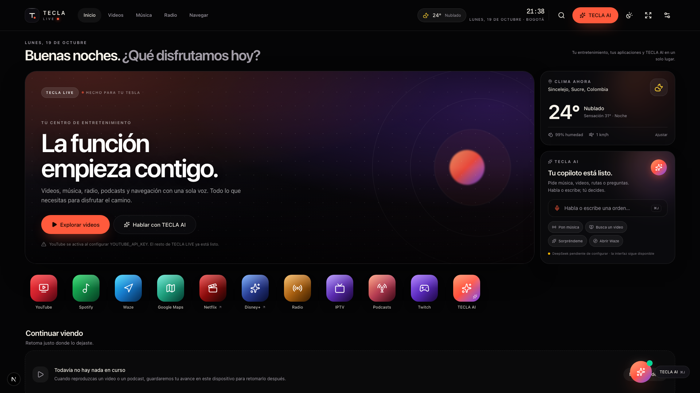

# TECLA LIVE

Centro de entretenimiento web premium para el navegador del Tesla, con **TECLA AI** (texto y voz), YouTube, radio, podcasts, navegación, IPTV, Twitch, Spotify y biblioteca local o sincronizada.

- **Stack:** Next.js 16 (App Router), React 19, TypeScript estricto, Tailwind CSS 4, componentes shadcn-style sobre Radix, Zustand, TanStack Query, Zod, Prisma/PostgreSQL.
- **IA:** DeepSeek (razonamiento + herramientas), Deepgram (voz a texto), ElevenLabs (texto a voz).
- **Despliegue:** Docker multi-stage, Next standalone, salud en `/api/health`. Instrucciones en [docs/EASYPANEL.md](docs/EASYPANEL.md).



## Inicio rápido

```bash
cp .env.example .env
# Completa AUTH_SECRET, TOKEN_ENCRYPTION_KEY y las claves que quieras usar.
npm install
docker compose up -d db        # PostgreSQL local (o usa uno existente)
npm run db:migrate             # crea las tablas
npm run dev                    # http://localhost:3000
```

Genera secretos reales:

```bash
openssl rand -hex 32   # AUTH_SECRET
openssl rand -hex 32   # TOKEN_ENCRYPTION_KEY
```

Sin claves externas la app arranca en **modo degradado honesto**: clima (Open-Meteo), radio (Radio Browser), podcasts (iTunes), Waze/Maps y toda la interfaz funcionan; YouTube, IA y Spotify muestran su estado de configuración. El modo invitado guarda preferencias en el navegador.

## Comandos

```bash
npm run dev           # desarrollo
npm run build         # build de producción
npm run start         # servidor standalone de Next (tras build)
npm run typecheck     # TypeScript estricto
npm run lint          # ESLint
npm run test:run      # Vitest (45 pruebas)
npm run test:e2e      # Playwright (26 pruebas; requiere servidor y PostgreSQL para cuenta)
npm run db:migrate    # migración de desarrollo
npm run db:deploy     # migraciones en producción
npm run db:seed       # semilla opcional
```

## Qué está implementado

- Dashboard cinematográfico responsive con hero, clima real de Sincelejo, accesos rápidos, carruseles y estados de carga/error/vacío.
- Temas claro/oscuro/automático por horario, modos normal/cine/kiosco, pantalla completa con fallback y reducción de movimiento.
- YouTube Data API + reproductor oficial IFrame, tendencias de Colombia, búsqueda, historial, progreso, favoritos, listas y cola/minirreproductor.
- TECLA AI por texto y voz: orquestación DeepSeek con function calling, 21 herramientas tipadas, puente de acciones del navegador, límites de uso, presupuesto, memoria de preferencias consentida.
- Deepgram para transcripción push-to-talk, ElevenLabs para respuestas habladas con interrupción, selector de voces autorizadas y fallback textual.
- Radio Browser, iTunes Podcasts, M3U/IPTV con hls.js, Twitch embed, Waze/Google Maps con deep links oficiales y accesos a Netflix/Disney+.
- **Iconos de marca reales** para YouTube, Spotify, Waze, Google Maps, Netflix, Disney+, Podcasts y Twitch (Simple Icons, con atribución), integrados en el diseño TECLA.
- **Waze**: preparación de ruta y enlace al mapa en vivo oficial. Los avisos de huecos/cámaras pertenecen a Waze y no se reciben ni simulan dentro de TECLA LIVE.
- Spotify OAuth con tokens cifrados AES-256-GCM y controles remotos; sin simular reproducción local.
- Cuentas con sesión JWT HttpOnly, bcrypt, aislamiento por usuario y sincronización de biblioteca/preferencias con PostgreSQL.
- Docker multi-stage, usuario no root, health checks, migraciones y documentación de Easypanel.

## Integraciones y estado

Consulta `/settings` o `GET /api/integrations/status` para el estado real de cada integración. Las claves viven solo en el servidor.

| Integración | Variables principales |
| --- | --- |
| YouTube | `YOUTUBE_API_KEY` |
| DeepSeek | `DEEPSEEK_API_KEY`, `DEEPSEEK_MODEL` (`deepseek-chat` por defecto) |
| Deepgram | `DEEPGRAM_API_KEY`, `DEEPGRAM_MODEL` (`nova-3` por defecto) |
| ElevenLabs | `ELEVENLABS_API_KEY`, `ELEVENLABS_VOICE_ID` |
| Spotify | `SPOTIFY_CLIENT_ID`, `SPOTIFY_CLIENT_SECRET`, `SPOTIFY_REDIRECT_URI` |
| Base de datos / cuentas | `DATABASE_URL`, `AUTH_SECRET`, `TOKEN_ENCRYPTION_KEY` |
| Clima / radio / podcasts | Sin claves |

## Verificación disponible en este entorno

- `npm run typecheck`: sin errores.
- `npm run lint`: sin errores (5 avisos de la regla nueva `react-hooks/set-state-in-effect` en detecciones de hidratación/tiempo).
- `npm run test:run`: **45 pruebas unitarias aprobadas**.
- `npx playwright test`: **26 pruebas E2E aprobadas**, incluye registro/sincronización real contra PostgreSQL, navegación móvil, minirreproductor, IPTV y modo cine.
- PostgreSQL 16 en Docker, migración inicial aplicada, health check con `database: connected`.
- Dockerfile multi-stage compilado y ejecutado como usuario no root; `docker compose` levanta base de datos, aplica migraciones y arranca la app con health check.
- Function calling de TECLA AI verificado de extremo a extremo con **DeepSeek real**: herramienta de clima en servidor, acción de cliente `set_display_mode` y registro de uso en PostgreSQL. También se probó antes con un mock local sin coste.
- **Integraciones reales probadas el 2026-10-20:** YouTube (búsqueda, tendencias y reproductor), DeepSeek (texto + tool + acción UI), ElevenLabs (MP3), Deepgram (transcripción del MP3). Spotify validó credenciales y redirect; falta vincular la cuenta. Evidencia en [docs/INTEGRATION-TEST.md](docs/INTEGRATION-TEST.md).
- Rutas externas verificadas manualmente: clima Open-Meteo, geocodificación, Radio Browser e iTunes.

## Limitaciones declaradas

- No se probó en el navegador de un Tesla ni en Easypanel/tecla.live desde este entorno.
- Spotify requiere que el usuario autorice su cuenta y tenga Premium con un dispositivo activo. La prueba de reproducción real queda pendiente.
- El micrófono físico no se pudo automatizar con el dispositivo simulado de Chromium; el backend de Deepgram sí se probó con audio real. La captura desde micrófono queda para prueba manual.
- La transcripción es push-to-talk con envío al backend; no hay transcripción parcial en streaming. Se documenta como limitación y se libera el micrófono al terminar.
- Los podcasts reproducen el avance público de iTunes; el episodio completo se abre en su proveedor.
- El rate limiting es en memoria (una instancia); para varias réplicas debe migrarse a PostgreSQL/Redis.
- Las variables `NEXT_PUBLIC_*` se inyectan al compilar. Configura `NEXT_PUBLIC_APP_URL=https://tecla.live` como build arg al construir la imagen de producción.
- `npm audit --omit=dev` marca 3 avisos altos en la cadena del CLI de Prisma (`deepmerge-ts`). El CLI no forma parte de la imagen runtime; solo lo usa la imagen de migración con el schema del repositorio. La corrección requiere migrar a Prisma 7 (cambio mayor) y queda como deuda técnica declarada.
- TECLA AI no sustituye controles manuales: si una acción del navegador se bloquea, se informa y se ofrece alternativa.
- El agente de programación (DeepSeek Harness) es distinto de TECLA AI de producto. Este repositorio documenta ambos en [AGENTS.md](AGENTS.md), [DEEPSEEK.md](DEEPSEEK.md), [memori.md](memori.md) y [GOAL_LOOP.md](GOAL_LOOP.md).

## Documentación

- [Plan técnico](PLAN.md) · [Tareas](TASKS.md) · [Memoria](memori.md) · [Goal Loop](GOAL_LOOP.md)
- [Manual técnico y convenciones](DEEPSEEK.md) · [Reglas del agente](AGENTS.md)
- [Despliegue en Easypanel](docs/EASYPANEL.md)
- [Alcance real de Waze](docs/WAZE.md) · [Marcas y atribuciones](docs/ATTRIBUTION.md) · [Prueba real de integraciones](docs/INTEGRATION-TEST.md)

Hecho para disfrutar el camino. No manipules la pantalla mientras conduces.
