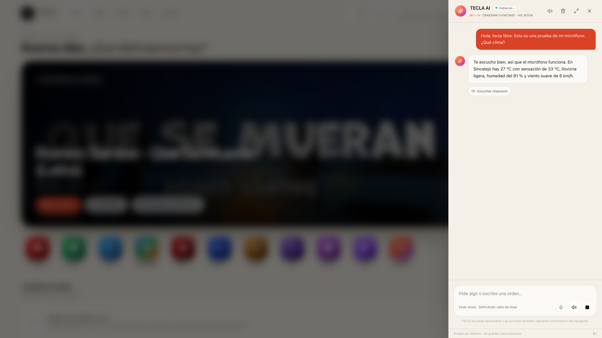

# Fix del flujo de micrófono

## Síntoma

El micrófono parecía no funcionar: se podía grabar, Deepgram devolvía HTTP 200, pero la interfaz se quedaba en **«Transcribiendo…»** y nunca aparecía la transcripción ni la respuesta de TECLA AI.

## Causa raíz

En `src/features/ai/hooks/use-tecla-ai.ts`, `recorder.onstop` hacía:

1. `setStatus("transcribing")`
2. `await send(transcript, { speak: true })`

Pero `send()` rechaza cualquier orden si el estado global es ocupado (`thinking`, `executing`, `transcribing`, etc.). La transcripción llegaba bien, pero se descartaba silenciosamente y el estado quedaba atascado en `transcribing`.

## Corrección

Antes de encadenar la transcripción se libera explícitamente el estado:

```ts
useAi.getState().setStatus("idle");
await send(transcript, { speak: true });
```

Así la transcripción se convierte en un mensaje real y se ejecuta el ciclo normal de TECLA AI.

## Verificación completa del path del micrófono

Se inyectó un `MediaStream` de audio en el navegador (a través de `getUserMedia`), que es exactamente el mismo camino que usa el micrófono real:

```text
getUserMedia → MediaRecorder → POST /api/ai/stt → Deepgram
→ transcripción → POST /api/ai/chat → DeepSeek
→ respuesta → POST /api/ai/tts → ElevenLabs
```

Resultado observado:

- `/api/ai/stt`: **200**
- `/api/ai/chat`: **200**
- `/api/ai/tts`: **200**
- Transcripción visible: «Hola, tecla libre. Esta es una prueba de mi micrófono. ¿Qué clima?»
- Respuesta visible con clima real de Sincelejo.
- Sin errores de página.



> El hardware físico no se automatizó: la prueba usa audio inyectado en el navegador, no el micrófono de la Mac. El permiso del micrófono y el dispositivo real deben probarse en el navegador de destino. Lo que sí quedó verificado es todo el código de captura, subida, transcripción, envío y respuesta.

## Despliegue

Este fix también requiere reconstruir y redesplegar tecla.live. El repo contiene el cambio; no se desplegó desde este entorno.
