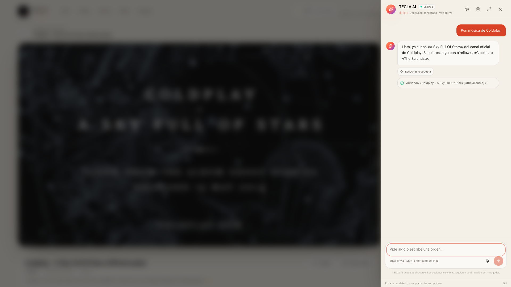

# Fix del reproductor `/watch/[videoId]`

## Síntoma

Al pedir «Pon música de Coldplay», TECLA AI abría un video y la página completa mostraba:

> This page couldn't load. Reload to try again, or go back.

Ocurría tanto en `tecla.live` como en local, así que no era un problema de la base de datos ni del despliegue.

## Causa raíz

`YT.Player` de YouTube **reemplaza el elemento DOM que recibe por su propio iframe**. El reproductor estaba usando un `<div id="...">` que React consideraba suyo. Cuando React intentaba actualizar o desmontar ese nodo, el iframe ya lo había sustituido y el navegador lanzaba:

```text
NotFoundError: Failed to execute 'removeChild' on 'Node':
The node to be removed is not a child of this node.
```

Ese error no capturado rompía el árbol de React y Next mostraba la página genérica de error.

## Corrección

En `src/components/media/youtube-player.tsx`:

- React ahora solo controla un contenedor estable (`hostRef`).
- Dentro de ese contenedor se crea un nodo hijo **fuera de React**; YouTube puede reemplazarlo por su iframe sin romper la reconciliación.
- La limpieza destruye el player y vacía el contenedor de forma imperativa.
- Se eliminó el `id` generado por React como objetivo directo de YouTube.

Además:

- `src/lib/integrations/youtube.ts` filtra los resultados con `status.embeddable === false`.
- Las búsquedas priorizan el canal oficial del artista para evitar compilaciones/fan edits que suelen bloquear la reproducción incrustada.
- El prompt de TECLA AI prefiere versiones oficiales y no insiste con un ID que el reproductor reporte como bloqueado.

## Verificación

- El video reportado (`xQt87UcxeJs`, con embedding deshabilitado) ya **no rompe la página**: muestra el mensaje controlado «El propietario no permite reproducir este video fuera de YouTube» y el botón «Abrir en YouTube».
- Un video oficial de Coldplay (`RB-RcX5DS5A`) carga el iframe de YouTube correctamente.
- La frase «Pon música de Coldplay» ahora eligió «A Sky Full Of Stars (Official audio)» del canal oficial de Coldplay y cargó el iframe, sin errores de página.
- Pruebas manuales repetidas en Chromium sobre el build de producción local.



## Despliegue

El fix está en el repo; hay que **reconstruir y redesplegar** la imagen en Easypanel/tecla.live para que producción lo use. No se modificó la base de datos ni se ejecutó ningún despliegue desde este entorno.

## Incidencia separada: certificado TLS

`https://tecla.live` está sirviendo un certificado autofirmado:

```text
subject=CN=Easypanel
issuer=CN=Easypanel
```

Hay que emitir/instalar un certificado Let's Encrypt para `tecla.live` en Easypanel. Sin eso, los navegadores y el navegador del Tesla mostrarán advertencias de seguridad, aunque la app cargue tras aceptar la excepción.

## Pruebas automatizadas

- Vitest: 45/45.
- Playwright: 26/26, actualizadas para funcionar tanto con claves configuradas como sin ellas.
