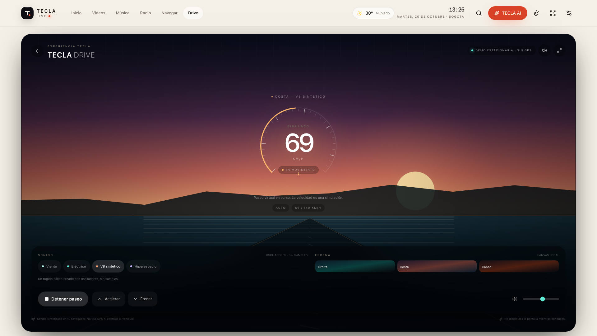
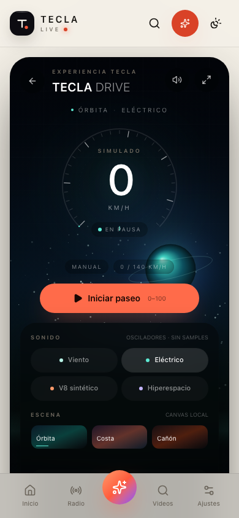

# TECLA DRIVE

Experiencia original de sonido y paisaje integrada en TECLA LIVE, inspirada conceptualmente en las demos de sonido para vehículos eléctricos. **No usa código, audio, imágenes, textos ni escenas de EV Sound FX.** No existe afiliación con ese producto.

## Qué incluye

- Ruta `/drive`, accesible desde la navegación principal, los accesos rápidos y la sección **Experiencias** de `/apps`.
- Canvas 2D dibujado completamente en el navegador:
  - **Órbita**: campo de estrellas, planeta y horizonte.
  - **Costa**: atardecer, agua, silueta costera y camino.
  - **Cañón**: capas de montañas, estrellas y camino.
- Gauge circular con velocidad simulada de 0 a 140 km/h.
- Paseo virtual 0–100 en un toque, con acelerador y freno de pulsación sostenida.
- Cuatro paisajes sonoros originales, sintetizados con Web Audio:
  - **Viento**
  - **Eléctrico**
  - **V8 sintético**
  - **Hiperespacio**
- Control de volumen, silencio, pantalla completa y parada automática al ocultar la pestaña.
- Diseño responsive para tesla horizontal, tablet y móvil.

## Privacidad y seguridad

- **No usa GPS ni datos del vehículo.** La velocidad es una simulación estacionaria.
- No reproduce audio hasta que el usuario pulsa **Iniciar paseo**.
- El sonido se sintetiza en el navegador mediante osciladores y ruido filtrado; no hay samples descargados.
- No controla el vehículo ni la bocina de peatones.
- La UI recuerda no manipular la pantalla mientras se conduce.
- No se solicita micrófono, ubicación ni cámara.

## Restricciones

- La calidad percibida del audio depende de los altavoces, el volumen del navegador y las políticas de autoplay del vehículo.
- Algunos navegadores de Tesla pueden suspender el audio al cambiar de pestaña o al entrar en segundo plano; la experiencia se detiene de forma segura.
- El renderizado usa Canvas 2D y un `AudioContext`; si Web Audio no está disponible, la simulación visual sigue funcionando y se muestra un aviso.
- El rendimiento del canvas se limita a DPR 1.75 y se pausa cuando la página no está visible.

## Implementación

- `src/features/drive/drive-experience.tsx`: HUD, controles y ciclo de vida del audio.
- `src/features/drive/drive-canvas.tsx`: escenas Canvas 2D originales.
- `src/features/drive/audio-engine.ts`: síntesis Web Audio.
- `src/features/drive/use-drive-simulation.ts`: simulación de velocidad y pedales.
- `src/features/drive/drive-config.ts`: catálogo de escenas/sonidos y funciones puras.
- `src/features/ai/tools/schemas.ts`: `drive` añadido a las apps que TECLA AI puede abrir.

## Verificación

- Typecheck/build de producción correctos a través de la imagen Docker.
- 49 pruebas unitarias aprobadas.
- 27 pruebas E2E aprobadas, incluida la apertura de TECLA Drive, cambio de escena e inicio del paseo.
- Verificación de audio en Chromium: 1 `AudioContext` en estado `running` y 5 osciladores creados para el preset V8.

