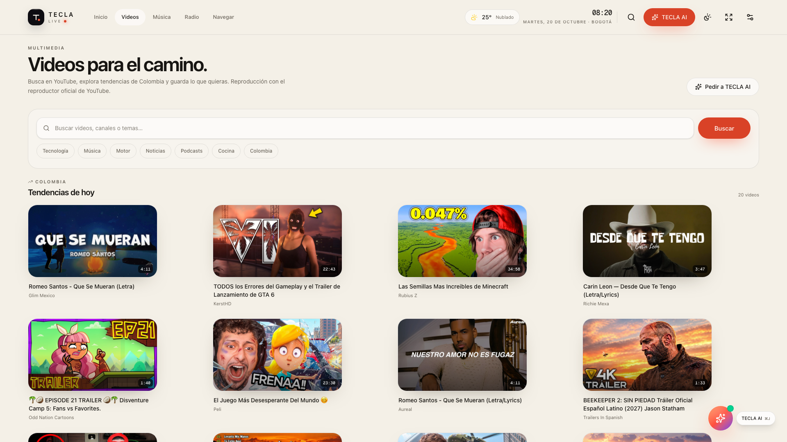
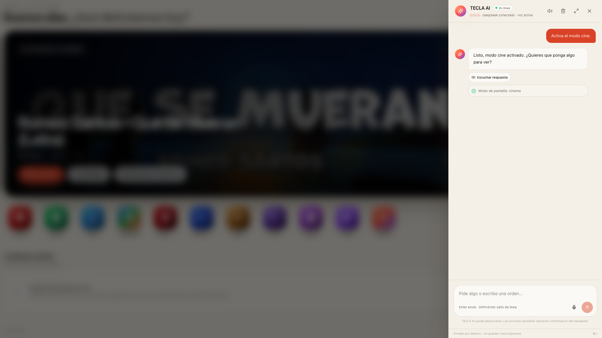

# Prueba real de integraciones — 2026-10-20

> Entorno: build de producción en Docker (`localhost:3000`), PostgreSQL 16 local, claves reales cargadas en `.env` y **nunca mostradas en logs ni documentación**. Pruebas mínimas para verificar funcionamiento, no para consumir cuota.

## Resultado general

| Integración | Prueba | Resultado |
| --- | --- | --- |
| **YouTube** | `GET /api/youtube/search?q=tecnologia&limit=2` | ✅ 2 videos reales con título, canal, miniatura y duración. |
| **YouTube** | Página `/youtube` y reproductor `/watch/[id]` | ✅ Tendencias de Colombia con 20 videos, metadatos y reproductor IFrame cargados. |
| **DeepSeek** | Chat real + herramienta `get_weather` | ✅ Respuesta: «En Sincelejo hay 25 °C con cielo nublado (sensación de 31 °C y 93 % de humedad)». |
| **DeepSeek + action bridge** | Orden «Activa el modo cine» desde el panel | ✅ Llamada real, acción `set_display_mode` ejecutada y resumen visible. |
| **ElevenLabs** | `POST /api/ai/tts` | ✅ `audio/mpeg`, 60 KB, MP3 128 kbps 44.1 kHz mono. |
| **Deepgram** | `POST /api/ai/stt` con el MP3 anterior | ✅ Transcripción: «Hola, TeclaLife. Esta es una prueba real de voz con Eleven Labs.» · confianza 0.996 · 3.84 s. |
| **UI de voz (salida)** | Botón «Escuchar respuesta» en TECLA AI | ✅ `POST /api/ai/tts` 200 desde la interfaz; estado de voz conectado. |
| **Spotify** | Credenciales de cliente | ✅ `client_credentials` HTTP 200. |
| **Spotify** | `/api/spotify/login` y authorize de Spotify | ✅ Redirección a `accounts.spotify.com`, scopes correctos, redirect URI `http://localhost:3000/api/spotify/callback`, state presente, página de login de Spotify sin error de redirect. |
| **Spotify** | Cuenta vinculada / reproducción | ⏳ Pendiente: requiere que el usuario autorice su cuenta de Spotify y tenga Premium con un dispositivo activo. No se automatizó el login por seguridad. |
| **Micrófono (pipeline)** | `getUserMedia` → MediaRecorder → STT → chat → TTS con audio inyectado en el navegador | ✅ Flujo completo verificado: STT 200, chat 200, TTS 200, transcripción visible y respuesta de clima. Se corrigió un estado `transcribing` que bloqueaba el envío. Ver [BUGFIX-VOICE.md](BUGFIX-VOICE.md). |
| **Micrófono físico** | Permiso y hardware real en el navegador | ⏳ El audio inyectado valida el código; falta probar el dispositivo/permit del usuario. |
| **Waze** | Rutas y avisos | ⚠️ Rutas/deep links ✅. Los avisos de huecos/cámaras no tienen API pública y no se simulan; ver [WAZE.md](WAZE.md). |

## Evidencia visual

## Consumo estimado

Registro `AIUsageEvent` acumulado de las pruebas (tarifas de referencia, no factura final):

| Proveedor | Eventos | Unidades | Estimado USD |
| --- | ---: | ---: | ---: |
| DeepSeek | 9 | 17 904 entrada / 626 salida | 0.005703 |
| ElevenLabs | 2 | 123 caracteres | 0.006150 |
| Deepgram | 1 | 4 s | 0.000493 |
| **Total** | **12** | — | **≈ 0.012346** |

No se hicieron pruebas masivas ni llamadas innecesarias. El presupuesto mensual configurado sigue en USD 10.

## Notas

- El modelo configurado en este entorno fue `deepseek-flash` y respondió correctamente. Si el proveedor deja de ofrecerlo, usa `deepseek-chat`.
- Spotify verifica credenciales y redirect; para completar la prueba de reproducción hay que pulsar **Vincular Spotify** en `/music` y autorizar la cuenta.
- La prueba de UI con acción real cerró el ciclo `DeepSeek → tool call → action bridge → interfaz → resultado real`.
- No se registraron claves, tokens, correos ni transcripciones en logs públicos. Las claves permanecen en `.env` (ignorado por Git) y en el entorno del contenedor.
